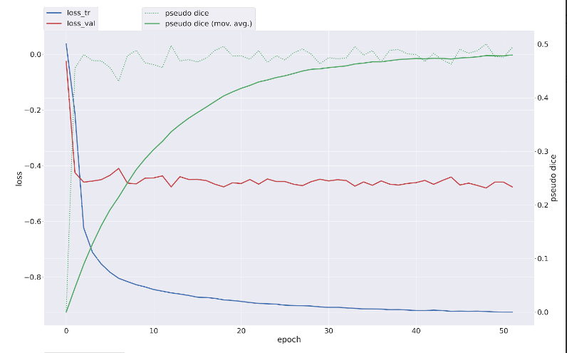
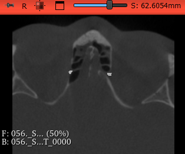
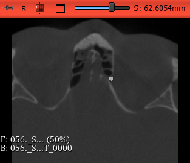
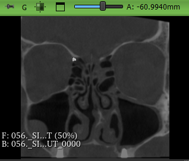
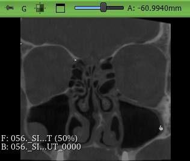
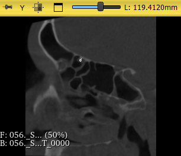
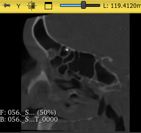
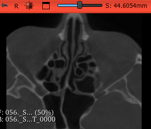
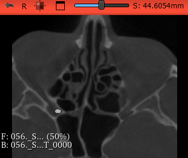
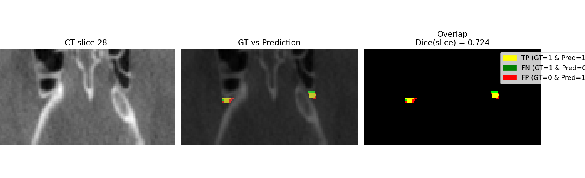

#  Segmentare Imagistică Medicală cu nnUNet

## 1. Setul de Date

### 1.1 Descrierea Setului de Date
**Sursa datelor:**  
Datele provin de la medicii cu care colaborăm.

**Modul de colectare:**  
Imagini CT de la pacienți, colectate în scopuri educaționale și de cercetare.

---

## 2. Algoritmul AI Ales

### 2.1 Descrierea Algoritmului
Algoritmul utilizat pentru segmentarea imaginilor medicale este un model **nnUNet**, parte a familiei de rețele neuronale convoluționale (**CNN**).  
Acest model s-a dovedit eficient în segmentarea imaginilor medicale deoarece poate învăța atât reprezentări **locale**, cât și **globale**, menținând o performanță ridicată chiar și pe seturi mici de date.

**Motivul alegerii:**
- Arhitectura UNet combină etapele de *encoding* (extracția trăsăturilor) și *decoding* (reconstrucția imaginii), permițând o segmentare precisă a structurilor importante din imagini.

**Librării folosite:**
- `PyTorch` – pentru implementarea rețelei neuronale  
- `nnUNet` – implementare optimizată pentru segmentare medicală  
- `SimpleITK` – pentru citirea și procesarea imaginilor în formate `.nii` și `.dcm`

---

## 3. Explorarea și Analiza Datelor (EDA)

### 3.1 Descrierea Setului de Date
- **Dimensiuni:** Aproximativ `[X, X, X]` pixeli (în funcție de imaginea originală), X = [100, 256]  
- **Structură:** Fiecare imagine are asociată o **mască de segmentare** care indică zonele de interes: 1 - artera din stanga, 2 - artera din dreapta si 0 - background

### 3.2 Analiza Exploratorie
- **Distribuția intensităților:**  
  Analiza statisticilor de bază (medie, deviație standard, minim, maxim) este esențială pentru înțelegerea distribuției valorilor pixelilor.  
  În cazul imaginilor CT, intensitățile pot varia semnificativ în funcție de regiunea anatomică.

---

## 4. Metodologia Experimentală și Rezultate 

## 🧪 Experiment 1 – Configurație 2D de bază pe un nnUnet simplu
#### 1.1 Împărțirea Setului de Date (16 date)
- **Train set:** 80% din imagini (≈ 12 pacienți)  
- **Validation set:** 20% din imagini (≈ 4 pacienți)
- **Prediction set:** (≈ 4 pacienți) (pacientii 17 - 20)

#### 1.2 Metrici Folosite
- **Dice Coefficient:** Principalul indicator al calității segmentării   
- **Loss Function:** `Dice Loss`

#### 1.3 Hiperparametri Utilizați
| Parametru         | Valoare  | Observații |
|-------------------|-----------|------------|
| Batch size        | 65        | Set mic de date |
| Learning rate     | 0.01      | Evitare overfitting |
| Epochs            | 100       | Stabilizare model |
| Configurație      | 2D        | Procesare 2D |

#### 1.4 Rezultate
- **Pseudo Dice score:** `0.22` (16 cazuri: 12 train / 4 val)  
- **Observație:** Modelul învață, dar performanța este scăzută pe setul mic de date.

#### 1.4 Imbunatațiri posibile
- Aplicarea unui **crop** pe imagini pentru excluderea zonelor neinformative (pixeli 0)  
- Eliminarea imaginilor din capetele volumelor (unde nu există structuri de interes)  
- Antrenarea pe un **set mai mare de date** (~20)
- Folosirea aceluiași set pentru **validare** în scop comparativ  

---

### 🧪 Experiment 2 – Configurație 3D Fullest pe un nnUnet simplu
#### 2.1 Împărțirea Setului de Date (16 date)
- **Train set:** 80% (≈ 12 pacienți) (pacientii 1 - 12 ) 
- **Validation set:** 20% (≈ 4 pacienți) (pacientii 13 - 16)

#### 2.2 Metrici Folosite
- **Dice Coefficient**, **Loss:** `Dice Loss`

#### 2.3 Hiperparametri Utilizați
| Parametru         | Valoare  | Observații |
|-------------------|-----------|------------|
| Batch size        | 65        | Aceeași ca în Exp. 1 |
| Learning rate     | 0.01      | Constant |
| Epochs            | 100       | |

#### 2.4 Rezultate
- **Pseudo Dice score:** `0.00`  
- **Observație:** Pe viitor de vazut predictiile.

---

### 🧪 Experiment 3 – Configurație 2D pe un nnUnet simplu cu date crop-uite global
#### 3.1 Împărțirea Setului de Date (45 de date)
- **Train set:** (≈ 41 pacienți) (pacientii 1 - 12; 17-45 ) 
- **Validation set:** (≈ 4 pacienți) (pacientii 13 - 16)

#### 3.2 Metrici Folosite
- **Dice Coefficient**, **Loss:** `Dice Loss`

#### 3.3 Hiperparametri Utilizați
| Parametru         | Valoare  | Observații |
|-------------------|-----------|------------|
| Batch size        | 65        | Aceeași ca în Exp. 1 |
| Learning rate     | 0.01      | Constant |
| Epochs            | 50       | |

#### 3.4 Rezultate
- **Pseudo Dice score:** `0.16`  
- **Observație:** Am extras valori first/last pentru cand apare segmentarea pentru cei 45 de pacienti, am calculat valori globale, si am facut crop in functie de aceste peste toate cazurile.

---

### 🧪 Experiment 4 – Configurație 2D pe un nnUnet simplu cu date crop-uite individual (safe margin = 25)
#### 4.1 Împărțirea Setului de Date (45 de date)
- **Automat:** nnUNet permite impartira automata a datelor de catre el

#### 4.2 Metrici Folosite
- **Dice Coefficient**, **Loss:** `Dice Loss`

#### 4.3 Hiperparametri Utilizați
| Parametru         | Valoare  | Observații |
|-------------------|-----------|------------|
| Batch size        | 65        | Aceeași ca în Exp. 1 |
| Learning rate     | 0.01      | Constant |
| Epochs            | 32       | |

#### 4.4 Rezultate
- **Pseudo Dice score:** `0.50`  
- **Observație:** Cea mai bună de pana acum

#### 4.4 Imbunatațiri posibile
- Aplicarea unui **crop** mai restrans, plus eliminarea capetelor mai restranse

---

### 🧪 Experiment 5 – Configurație 2D pe un nnUnet simplu cu date crop-uite individual (safe margin = 15), cu crop-ul mai "agresiv"
#### 5.1 Împărțirea Setului de Date (57 de date)
- **Automat:** nnUNet permite impartira automata a datelor de catre el: 
- **Train set:** (≈ 44 pacienți) (pacientii: restul ) 
- **Validation set:** (≈ 11 pacienți) (pacientii: 7, 13, 26, 29, 32, 36, 39, 41, 44, 48, 49)
- **Prediction set:** (≈ 2 pacienți) (pacientii 55 - 57)

#### 5.2 Metrici Folosite
- **Dice Coefficient**, **Loss:** `Dice Loss`

#### 5.3 Hiperparametri Utilizați
| Parametru         | Valoare  |
|----------------------|--------------|
| Batch size        | 146        | 
| Patch size        | [56, 128]       |  
| Learning rate     | 0.01      | 
| Epochs            | 51       | 
| median_image_size_in_voxels |[55.0, 119.0]     | 

#### 5.4 Rezultate
- **Pseudo Dice score:** `0.47`  
- **Observație:** Celalt a fost mai bun, poate trebuie un crop mai bun.

#### 5.4 Imbunatațiri posibile
- De crop-uit imaginea inainte de a fi trimisa la predic cu valori globale de crop
- De adaugat restul de date pana la 105, poate de modificat crop-ul sa fie mai lejer
- De rotit datele (augumentare)

#### 5.5 Analiza model
-  La epoca 51 train_loss a ajuns la `-0.92`, iar val_loss la `-0.47`
- Timpul aproximativ per epoca este de `429 s ~ 7 min`
- Timp pentru predictie pentru o imagine full (> 10.000MB) de `~01:34 min`
- Pana la epoca 38, dice-ul crestea cu `~1%` per epoca, dar pe urma a inceput sa creasca greu, cateodata deloc
- Learning rate-ul a inceput de la `0.00999`, iar la epoca 51 a ajuns la `0.00954`
- In plot se observa loss-ul pentru trining si loss pentru validare, precum si dice-ul
](image.png)

#### 5.6 Vizualizare predictii
| Segmentare reala  | Predictie |
|-------------|---------------|
|  |  |
|  |  |
|  |  |
|  |  |
---

### 🧪 Experiment 6 – Configurație 2D pe un nnUnet simplu cu date crop-uite individual (safe margin = 25)
#### 6.1 Împărțirea Setului de Date (105 de date)
- **Automat:** nnUNet permite impartira automata a datelor de catre el: 
- **Train set:** (≈ 102 pacienți) 
- **Validation set:** (≈ 26 pacienți)
- **Prediction set:** (≈ 2 pacienți) (pacientii 56 - 57)

#### 6.2 Metrici Folosite
- **Dice Coefficient**, **Loss:** `Dice Loss`

#### 6.3 Hiperparametri Utilizați
| Parametru         | Valoare  |
|-------------------|-----------|
| Batch size        | 65        |
| Learning rate     | 0.01      |
| Epochs            | 103       |

#### 6.4 Rezultate
- **Pseudo Dice score:** `0.52` 
- **Observație:** De vazut ce se intampla pana la 1000 de epoci
---

### 🧪 Experiment 7 – Configurație 3D_fullres pe un nnUnet simplu cu date crop-uite individual (safe margin = 25)
#### 7.1 Împărțirea Setului de Date (105 de date)
- **Automat:** nnUNet permite impartira automata a datelor de catre el (128 (80% - 20%) pentru nnUNet + 2 pentru predictie): 
- **Train set:** (≈ 102 pacienți) 
- **Validation set:** (≈ 26 pacienți)
- **Prediction set:** (≈ 2 pacienți) (pacientii 56 - 57)

#### 7.2 Metrici Folosite
- **Mean Dice validation:**, **IoU**

#### 7.3 Hiperparametri Utilizați
| Parametru         | Valoare  |
|-------------------|-----------|
| Batch size        | 5        |
| Learning rate     | 0.01      |
| Epochs            | 1000       |

#### 7.4 Rezultate
- **Mean Dice validation:** `0.5344415931627216`
- **Pseudo Dice score:** `0.60`
- **FN** `105.65384615384616`
- **FP** `40.53846153846154`
- **IoU** `0.3781709335236485`
- **TN** `406775.92307692306`
- **TP** `79.76923076923077`
- **n_pred** `120.3076923076923`
- **n_ref** `185.42307692307693`
- **Timp Predictie** `16s`
- **Observație:** Cel mai bun de pana acum, de incercat fold_all

---

---

### Rezumat Performanță
| Experiment | Configurație | Pseudo Dice Score | Observații | Numar de date
|-------------|---------------|-------------|-------------|-------------|
| 1 | 2D | 0.22 | Performanță scăzută pe set mic | 16
| 2 | 3D fullest | 0.00 | De vazut predictiile | 16
| 3 | 2D + Crop global | 0.16 | Date prea grele pentru ai | 45
| 4 | 2D + Crop individual (safe margin = 25) | 0.50 | Crop ajută la curățarea datelor | 45
| 5 | 2D + Crop individual (safe margin = 15) | 0.47 | Crop cu safe margin de 25 a fost mai bun | 55
| 6 | 2D + Crop individual (safe margin = 25) | 0.52 | Urmeaza sa mai rulez pana la 1000 epoci | 128 + 2 pentru predictie
| 7 | 3D_fullres + crop25 | 0.60 |  | 128 + 2 pentru predictie

---

**În final**, proiectul pune bazele unui instrument de asistență digitală care, prin extinderea setului de date și optimizarea inferenței, poate deveni un standard în analiza preoperatorie radiologică.

---
