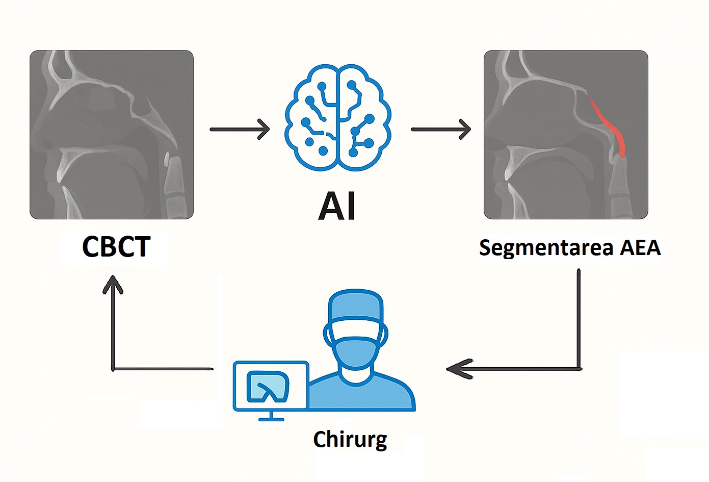

# 🩺 **Project 15 – 3D Segmentation of the Anterior Ethmoidal Artery on CBCT**

---

## 👩‍💻 **SEGMINIONS Team**
- **Negru Diana-Maria**  
- **Oproi Denisa-Florina**  
- **Ordean Anamaria**

---

## 🎯 **Problem Addressed**

Nasal endoscopic surgery requires **maximum precision**, as the accidental injury of the **anterior ethmoidal artery (AEA)** represents a frequent intraoperative risk.  
To reduce this risk, the **precise preoperative identification** of the AEA trajectory on **CBCT (Cone-Beam Computed Tomography)** images is essential.  

🔍 **Project Objective:**  
Developing an automated artificial intelligence system to **segment and localize the AEA** on CBCT scans, contributing to:  
- ✅ Increasing operative safety  
- ✅ Reducing the risk of vascular injury  
- ✅ Improving the accuracy and efficiency of nasal endoscopic interventions  

---

